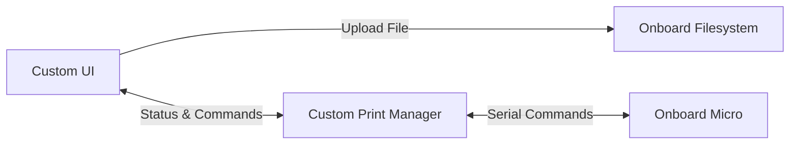

# Print Server Architecture

## High Level Design
The end goal of this project is to provide a tool to remotely upload print files to the printer
without the use of the Anycubic Cloud infrastructure. This is heavily inspired by the ease of use
PrusaSlicer provides. 

### Prototype:
I currently change slicers like the wind and have yet to land on a slicer program that I actually
like. For the MVP, my goal is to create a standalone application with the following behaviors:
- File Transfer from my desktop to the server.
- Print status monitoring
- Print initiation (maybe) 


```
```


