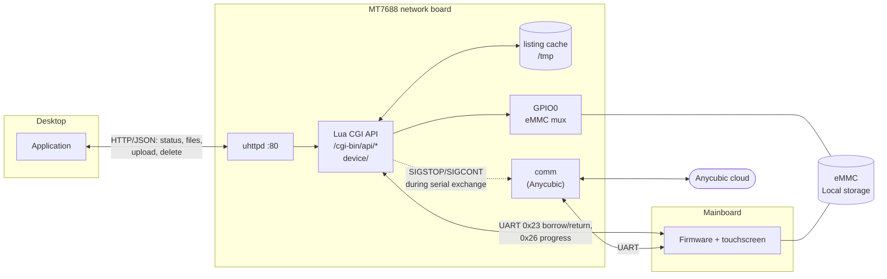

# Print Server Architecture

## Hardware
The M5s is a two-processor design:

- **Network board**: MediaTek MT7688 running OpenWrt 15.05.1 (Linux 3.18, MIPS32 LE,
  uClibc, ~7 MB flash). Runs Anycubic's `comm` daemon, which bridges the cloud (MQTT/HTTPS)
  to the mainboard over a UART (`/dev/ttyS1`, 115200 8N1). Root access is described in
  [local_access.md](local_access.md).
- **Mainboard**: ChiTu-style controller. Owns the touchscreen UI, motion and the print
  pipeline. On the serial link it only responds and never transmits on its own; the protocol is
  in [serial_interface.md](serial_interface.md).
- **Local storage**: an internal 3.64 GB eMMC (the touchscreen's *Local* tab), **shared**
  between the two boards through a mux on GPIO0. It normally belongs to the mainboard; the
  network board borrows it only while transferring files. The front **USB port is wired to the
  mainboard only**, so the network board never sees the USB stick.

## High Level Design
The end goal of this project is to provide a tool to remotely upload print files to the printer
without the use of the Anycubic Cloud infrastructure. This is heavily inspired by the ease of use
PrusaSlicer provides.

### Prototype:
I currently change slicers like the wind and have yet to land on a slicer program that I actually
like. For the MVP, my goal is to create a standalone application with the following behaviors:
- [x] File Transfer from my desktop to the server.
- [x] Print status monitoring *(raw pass-through only; field meanings still unknown)*
- [ ] Print initiation (maybe)

The printer already hosts a HTTP with a CGI that allows remote execution of onboard scripts.

### Borrowing the eMMC
Every request that touches the storage does what `comm` does for a cloud download, with one
extra safety check:

1. Refuse if a cloud job is running or another request holds `/tmp/printapi.lock`.
2. Pause `comm`, send the **0x23** "give eMMC to Linux" frame and read the mainboard's answer
   directly, then resume `comm`. Continue only if the answer is "released", so a mainboard
   that is printing from the eMMC can refuse.
3. Raise GPIO0, wait for `/dev/mmcblk0p1`, mount it.
4. Do the work (uploads also send **0x26** frames so the touchscreen shows a progress bar),
   then snapshot the file listing into the cache.
5. `sync`, unmount, lower GPIO0, send the "give it back" frame, release the lock.

Borrowing costs about 10 s plus transfer time, and the touchscreen's Local tab is unavailable
meanwhile. That's why `files` serves the **cached listing** by default and only re-reads the
eMMC when the user presses Refresh (`files?refresh=1`). Each upload or delete also updates the
cache, and `status` reports its timestamp so the app knows when to fetch the list again.

### Coexisting with `comm`
The prototype **leaves Anycubic's `comm` running**, so the cloud and the Anycubic app keep
working. The API only interferes with it briefly:
- It pauses `comm` for the ~2 s serial exchanges and for single progress-frame writes.
  `status` resumes `comm` if a request died while it was paused.
- It refuses to borrow storage while `comm` is handling a cloud job, and `comm` is assumed not
  to start one mid-transfer.

## Open Items
- **Print initiation**: needs the `STARTPRINT_REQUEST` (0x29) payload layout
  ([serial_interface.md § Open questions](serial_interface.md#open-questions)).
- **Status fields**: capture `print.json` / `local_print.json` / `print_msg.txt` during a real
  print so `status` can report progress, layer and ETA instead of raw pass-through.
- **Behaviour while printing**: confirm that the mainboard refuses the 0x23 request during a
  print (the API relies on this to never pull storage from under a running job).
- **Authentication**: the API is open to anyone on the LAN.
